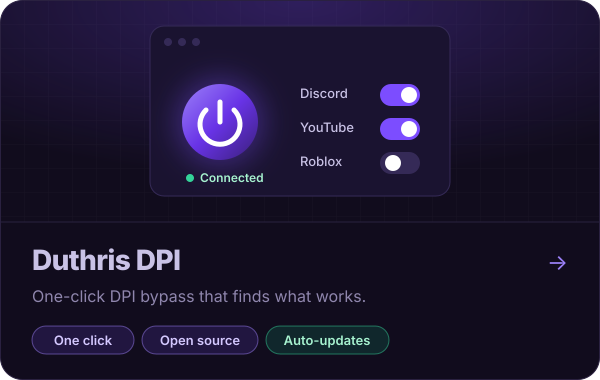

<picture>
  <source media="(prefers-color-scheme: light)" srcset="assets/hero-light.svg">
  
</picture>

I'm a full-stack software developer at **DT Cloud** in Antalya.

Outside work I make local-first apps that do the tedious part for you: one button, sensible defaults, nothing to configure.

Most of my day happens on Discord, so a lot of what I build starts there. I write bots that make my own servers easier to run and share them with the community as open source.

### Featured work

<table>
  <tr>
    <td width="50%" valign="top">
      <a href="https://github.com/Duthris/duthris-dpi">
        <picture>
          <source media="(prefers-color-scheme: light)" srcset="assets/card-dpi-light.svg">
          
        </picture>
      </a>
      Finds a working bypass method for your ISP on its own, remembers it per network, and repairs itself from the tray.
    </td>
    <td width="50%" valign="top">
      <a href="https://github.com/Duthris/duthris-iptv">
        <picture>
          <source media="(prefers-color-scheme: light)" srcset="assets/card-iptv-light.svg">
          
        </picture>
      </a>
      Live TV, films and series over catalogues of tens of thousands. Plays MKV and AC-3 by remuxing through a bundled FFmpeg.
    </td>
  </tr>
</table>

### Now · October 2026

- Taking **duthris-dpi** past its first release: more ISPs covered, faster detection.
- Polishing **duthris-iptv**: EPG timeline, TMDB artwork, encrypted backups.

---

[LinkedIn](https://www.linkedin.com/in/duthris/) · [Discord](https://discord.com/users/327431325147463681) · [Email](mailto:duthris@gmail.com) · Antalya, Türkiye (UTC+3)
